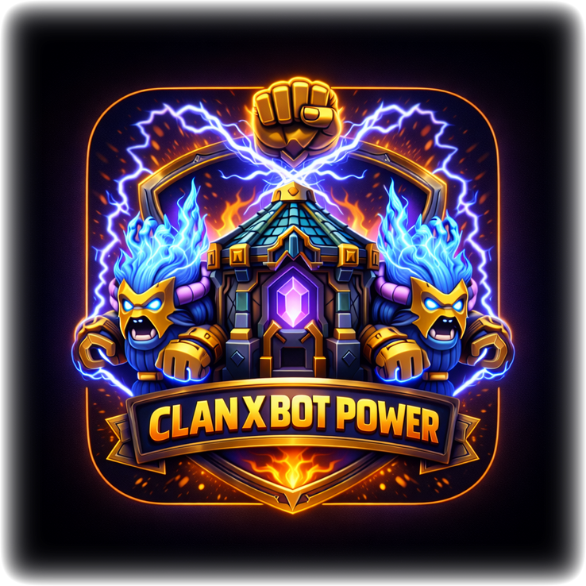

# 🏆 Clash Commander Bot

<p align="center">
  
</p>

A focused, modular **Discord operations bot** built for competitive Clash of Clans clans.

> Keeps your server clean, controlled, and battle-ready — quietly and efficiently.

---

## 🔗 Invite the Bot

Want Clash Commander in your server?  
👉 **Invite link coming soon**

---

## ✨ Key Capabilities

- 🧹 **Server Audits** — Roles, permissions, and bot safety checks  
- 🧠 **Clan Memory** — Member history, leadership notes, inactivity tracking  
- 🚨 **Command Authority** — Controlled leadership pings and actions  
- 🛡️ **Safety First** — No destructive permissions, no chaos  

---

## ⚔️ Command Arsenal

| Command | Description |
|------|------------|
| `/audit` | Server health & permission scan |
| `/whois` | Member snapshot |
| `/note` | Add leadership note |
| `/notes` | View member notes |
| `/inactive` | Inactivity report |
| `/ping mods` | Alert moderators |
| `/ping leaders` | Alert leadership |

---

## 📁 Structure Overview

```
src/
├─ index.js
├─ client.js
├─ deploy-commands.js
├─ commands/
├─ services/
├─ events/
└─ utils/
```

---

## 🧠 Design Philosophy

Clean systems win wars.  
Clash Commander stays silent until something matters.

---

Built with **discord.js**.
